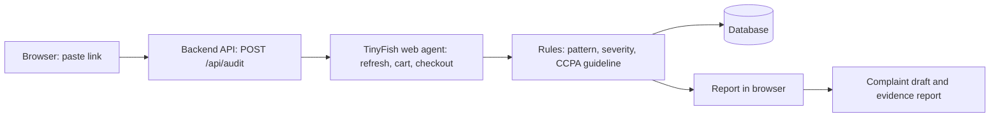

# DarkLens

> Paste a product link, get an evidence report on fake timers, false scarcity and hidden fees, mapped to India's 2023 CCPA dark pattern rules.

Built for HackIIITD 2026.

## The problem

Many shopping sites use design tricks ("dark patterns") that push people to spend more or decide in a hurry: countdown timers that quietly reset, "only 2 left" messages that are not true, and extra charges that appear only at checkout.

India's Central Consumer Protection Authority (CCPA) banned 13 such practices in its **Guidelines for Prevention and Regulation of Dark Patterns, 2023**. There are thousands of sites, pages change daily, and many tricks only appear when you interact with the page (refresh, add to cart, go to checkout). Checking by hand does not scale, and reading page text alone misses them.

## What DarkLens does

- Takes a product or checkout link.
- Sends an AI web agent ([TinyFish](https://docs.tinyfish.ai)) to open the page like a careful shopper: it refreshes to see if a timer resets, revisits to see if stock claims hold up, and compares the product price with the checkout total. It stops before payment.
- Turns the evidence into findings, each with a severity and the CCPA guideline it relates to.
- Shows a risk score and a report in the browser.
- Drafts a complaint for the National Consumer Helpline from the findings. The user reviews and files it themselves.
- Saves an evidence report (PDF) with the date, link, score, findings and the complaint draft.

## How it works



## Patterns covered

| CCPA 2023 pattern | DarkLens test | Status |
|---|---|---|
| False urgency | Fake timer: does the countdown reset after a refresh? | Built |
| False urgency | False scarcity: does an "only X left" claim hold up on a second visit? | Built (result is a suspicion, not proof) |
| Drip pricing | Hidden fees: does the checkout total exceed the price plus disclosed shipping? | Built |
| Basket sneaking, confirm shaming and the other patterns | - | Planned |

The CCPA lists 13 patterns. This prototype tests 2 of them (false urgency and drip pricing) through 3 checks.

## Tech stack

| Part | Choice |
|---|---|
| Frontend | HTML, CSS, JavaScript (no framework) in `public/` |
| Backend | Python with FastAPI |
| Web agent | TinyFish Agent API |
| Database | SQLite |
| Complaint and report | Built in the browser (no server needed) |

## Getting started

**Prerequisites:** Python 3.10 or newer, and a TinyFish API key.

```bash
git clone https://github.com/Vanshchawariya/darklens.git
cd darklens

python -m venv venv
venv\Scripts\activate          # Windows
# source venv/bin/activate     # macOS / Linux

pip install -r requirements.txt
```

Create a `.env` file (never commit it) based on `.env.example`:

```
TINYFISH_API_KEY=your-key-here
```

Start the app:

```bash
uvicorn main:app --reload
```

TODO: confirm the exact run command and folder if the backend lives in `backend/`.

Open `http://127.0.0.1:8000/`. The backend serves the page and the API from one address.

Click **Load sample report** to see the report without running the agent.

## API

`POST /api/audit`

Request:

```json
{ "url": "https://www.example.com/product/123" }
```

Response:

```json
{
  "findings": [
    {
      "type": "Fake timer",
      "severity": "high",
      "evidence": "Timer showed 09:59, then 09:59 again after refresh.",
      "location": "Product page, below the price",
      "advice": "Ignore the timer. The deal is not really ending.",
      "rule": "False urgency (CCPA 2023 dark pattern guidelines)"
    }
  ]
}
```

`severity` is `high`, `medium` or `low`. `rule` is optional: the frontend fills it in from the finding type if it is missing. A finding may also include a `screenshot` link, which the evidence report shows.

Other endpoints: `GET /api/health` and the interactive API docs at `/docs`. TODO: confirm these exist in the backend.

## Risk score

Each finding adds points by severity: high 30, medium 18, low 8. The total is capped at 100, and a higher score means more manipulation.

| Score | Level |
|---|---|
| 60 and above | High |
| 30 to 59 | Medium |
| Below 30 | Low |

These weights are our own choice for the prototype. They have not been calibrated against expert review.

## Project structure

```
darklens/
  public/        frontend: index.html, style.css, script.js
  main.py        backend entry point (TODO: confirm location)
  requirements.txt
  .env.example
  README.md
```

## Limitations

- Only 2 of the 13 CCPA patterns are tested.
- False scarcity gives a suspicion, not proof, because real stock levels are not visible.
- Sites may block the agent (logins, CAPTCHAs, bot protection), or show different prices by location or time.
- One audit is one moment in time. A clean result means "nothing found in these tests", not "compliant".
- A real countdown for a scheduled sale could be flagged wrongly, and a disclosed delivery fee could be mistaken for a hidden one.
- Agent runs take longer than a normal request and use paid credits.
- Results are test evidence, not a legal finding. Only the authorities can decide whether a practice is a violation.

## Responsible use

- Audits are read-only. DarkLens never completes a purchase and does not log in.
- Respect each site's terms of service.
- DarkLens is not affiliated with the Government of India, and it does not send complaints on anyone's behalf. The user files the complaint themselves on [consumerhelpline.gov.in](https://consumerhelpline.gov.in).
- Present findings as "possible dark patterns", especially when naming a company.

## Why this matters now

The Consumer Protection (E-Commerce) (Amendment) Rules, 2026 were notified in September 2026 and take effect on 1 January 2027. They require e-commerce entities to follow the dark pattern guidelines, run an annual self-audit and display a certificate, but, according to law-firm summaries, they do not say who audits, how, or what the certificate contains. Please verify against the official notification.

DarkLens aims to give platforms a way to check themselves before they certify, and regulators and consumer groups independent evidence afterwards.

## Roadmap

- Cover more CCPA patterns, starting with pre-ticked boxes (basket sneaking) and confirm shaming.
- Scheduled re-audits, audit history and a repeat-offender ranking.
- A browser extension for shoppers.
- An API platforms can call before each release.
- Checks for the 2026 rules, such as sponsored-listing labels and 30-day prior-price claims.

## Team

| Name | Role |
|---|---|
| TODO | PPT, pitch and research |
| TODO | Frontend |
| TODO | TinyFish agent and detectors |
| TODO | Backend, AI and data |

## License

TODO: add a license (for example MIT) or state "All rights reserved".